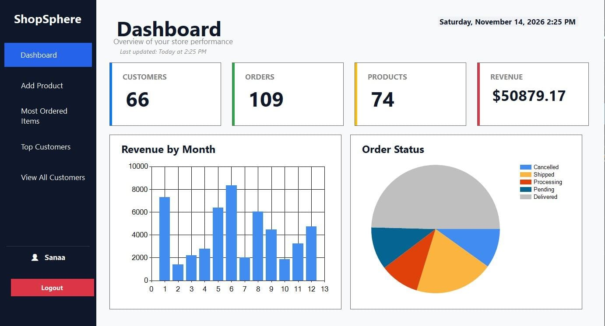
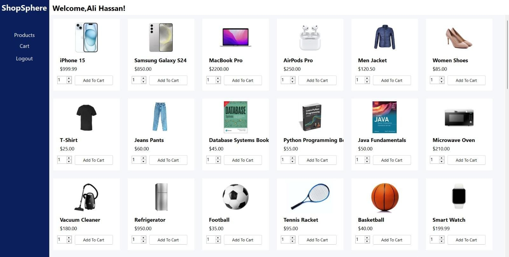

# ShopSphere – E-Commerce Management System

## Project Overview
ShopSphere is a desktop-based e-commerce management system developed using C# Windows Forms and a MySQL relational database. It integrates customer shopping functionalities with administrative management, providing a platform for browsing products, managing shopping carts, processing orders, and handling administrative operations.

This project was developed as part of my Computer Science studies to apply programming, object-oriented programming, relational database design, and SQL concepts in a practical software application.

## Technologies Used

- **Programming Language:** C#
- **Framework:** .NET Windows Forms
- **Database:** MySQL
- **Database Connectivity:** MySQL Connector for .NET
- **IDE:** Microsoft Visual Studio

## Key Features

### Customer Features
- User Registration and Login
- Product Browsing with Images
- Product Search
- Shopping Cart Management
- Quantity Management
- Automatic Total Price Calculation
- Checkout System
- Payment Options: Credit Card and Cash on Delivery

### Administration Features
- Admin Authentication
- Administration Dashboard
- Product Management
- Order Management
- Customer and Seller Information Management
- Category Management

## Technical Implementation

- Used C# Windows Forms to develop the desktop application.
- Connected the application to MySQL using MySQL Connector.
- Used SQL queries to retrieve and manage database records.
- Implemented shopping cart functionality using C# DataTable.
- Managed product quantities and calculated order totals.
- Organized application data using relational database tables.

## Database Design

ShopSphere uses a relational MySQL database consisting of 8 tables:

| Table | Description |
|---|---|
| `admin` | Stores administrator information |
| `category` | Stores product categories |
| `customers` | Stores customer information |
| `orderdetails` | Stores individual products within orders |
| `orders` | Stores customer order information |
| `payment` | Stores payment details |
| `product` | Stores product information and prices |
| `seller` | Stores seller information |

The complete database schema is provided in `database.sql`.

## Application Screenshots

### 1. Login Page
The login interface provides users with access to the application.

### 2. Admin Dashboard
The dashboard provides an overview of the e-commerce system and its administrative operations.

### 3. Product List
The product management interface displays product information and supports product administration.

## Project Structure

- **C# Forms:** Contains the application's Windows Forms, including `LoginForm.cs`, `admin.cs`, `cartForm.cs`, and other forms.
- **MySqldb.cs:** MySQL database connection and database operations.
- **ShoppingCart.cs:** Shopping cart data management.
- **database.sql:** Complete MySQL database structure.
- **Images:** Application screenshots - `Images/login.jpeg`, `Images/dashboard.jpeg`, `Images/products.jpeg`.
- **Properties:** Application resources - `Properties/Resources.resx`.
- **Visual Studio Solution:** `.sln` and `.csproj` files.

## How to Run

1. Clone or download this repository.
2. Open `Ray Sanaa Final Project.sln` in Visual Studio.
3. Import `database.sql` into MySQL using phpMyAdmin or MySQL Workbench.
4. Configure the MySQL connection settings in `MySqldb.cs`.
5. Restore the required NuGet packages if necessary.
6. Build and run the application.

## Skills Demonstrated

- Object-Oriented Programming (C#)
- Desktop Application Development
- Relational Database Design
- SQL and MySQL
- CRUD Operations
- Database Connectivity
- Shopping Cart and Order Processing
- User Interface Development

## Author

**Sanaa Khalaf**

Computer Science Student  
American University of Technology (AUT)

GitHub: [Sanaa-Data](https://github.com/Sanaa-Data)

---

